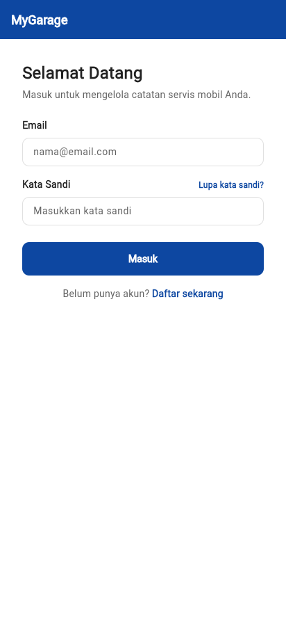
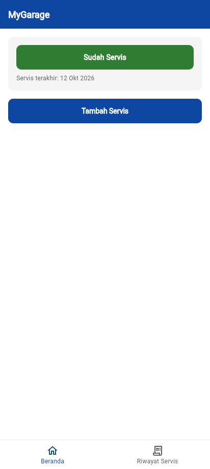
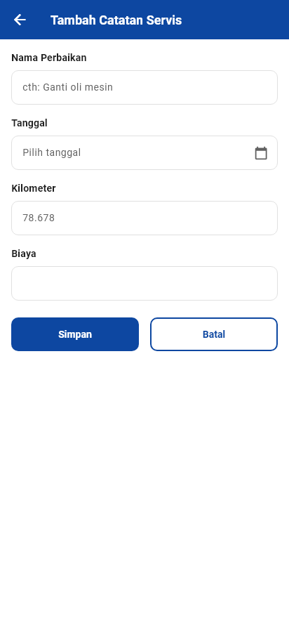
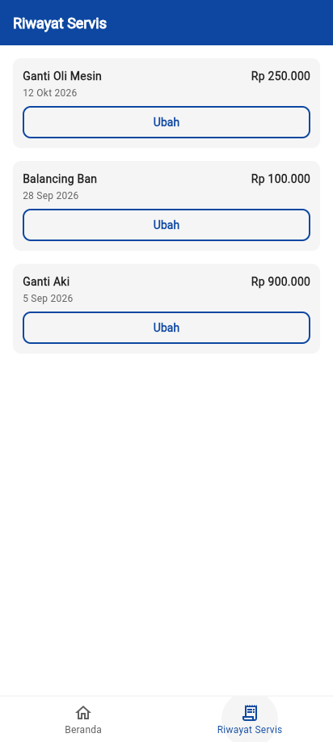

# MyGarage

**Buku servis digital untuk pemilik kendaraan bermotor** — catat riwayat perbaikan, biaya, dan dapatkan pengingat kapan servis berikutnya.

| | |
|---|---|
| Mahasiswa | Anggaradyan Jannes Minardi |
| NIM / Kelas | 22.01.65.0002 / A1 (Pagi) |
| Mata kuliah | Mobile and Web Application Development — UNISBANK, Ganjil 2026/2027 |
| Platform | Mobile + Web (Flutter cross-platform) |
| Wireframe | [2201650002 - MyGarage - Wireframe (Figma)](https://www.figma.com/design/S5iVPGaOGy1oqVoXQYsrmH/2201650002-MyGarage-Wireframe) |

## Deskripsi

Pemilik kendaraan saat ini mengandalkan nota kertas yang mudah hilang dan ingatan untuk jadwal servis. Akibatnya perawatan telat dan biaya perbaikan membengkak. MyGarage menggantinya dengan buku servis digital: setiap selesai dari bengkel, pengguna mencatat jenis perbaikan, tanggal, kilometer, dan biaya — aplikasi menampilkan riwayat terurut dan indikator pengingat (hijau = sudah servis, merah = sudah ≥3 bulan sejak servis terakhir).

## Fitur (MVP — sesuai MoSCoW worksheet Minggu 2)

- **K1 — Login** (MUST): halaman masuk email + kata sandi dengan keadaan galat. *(Saat ini masih simulasi lokal; integrasi Firebase Authentication direncanakan Pertemuan 9.)*
- **K2 — Tambah Catatan Servis** (MUST): form Nama Perbaikan, Tanggal (date picker), Kilometer, Biaya (Rp) — dengan validasi: jenis wajib, biaya wajib, biaya > 0, maksimal Rp 500.000.
- **K3 — Riwayat Servis** (MUST): daftar urut dari tanggal terbaru + keadaan kosong.
- **K4 — Indikator Pengingat** (MUST): blok hijau/merah di Beranda berdasarkan tanggal servis terakhir.
- **K5 — Responsif** (SHOULD): versi web memakai sidebar + tabel; versi mobile memakai bottom navigation + kartu.
- **K6 — Push Notification** (WON'T): sengaja tidak dibuat (melanggar batasan Firebase Spark tanpa billing).

## Screenshot

| Login | Beranda | Form Tambah | Riwayat Servis |
|---|---|---|---|
|  |  |  |  |

## Tech stack

- **Flutter + Dart** — UI dan logika (satu basis kode untuk Android & web)
- **Firebase Spark (gratis)** — Authentication (email/password), Cloud Firestore (data), Hosting (versi web) — *menyusul pada Pertemuan 9–10*
- **Figma** — wireframe & style guide (#0D47A1 navy, Inter 24/18/14/12, radius 10, target sentuh 48 px)
- **GitHub** — versi kode

## Rencana database (Firestore)

```
users/{uid}                    <- dokumen pengguna (dari Authentication)
  -> servis/{id}              <- sub-koleksi catatan servis per user
        jenis:      string     (cth: "Ganti Oli Mesin")
        tanggal:    timestamp  (tanggal servis)
        kilometer:  number     (opsional)
        biaya:      number     (rupiah)
```

Struktur `users/{uid}/servis/{id}` menjaga data tiap pengguna tetap privat (kebutuhan K1) dan membuat daftar riwayat per user efisien dibaca (K3).

## Cara menjalankan

```bash
flutter pub get
flutter run -d chrome          # versi web
flutter run                    # pilih device/emulator Android
```

Untuk melihat tampilan mobile di browser: Chrome -> F12 -> Toggle device toolbar (Ctrl+Shift+M) -> ukuran 412x917.

## Pengujian

```bash
flutter test     # 20 kasus: 6 unit aturan validasi + 13 widget + 1 alur login
flutter analyze  # No issues found
```
