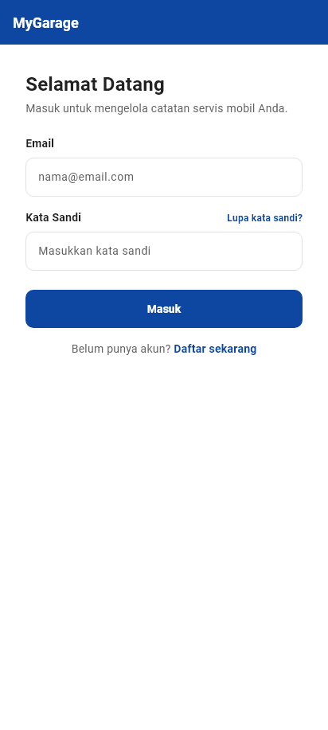
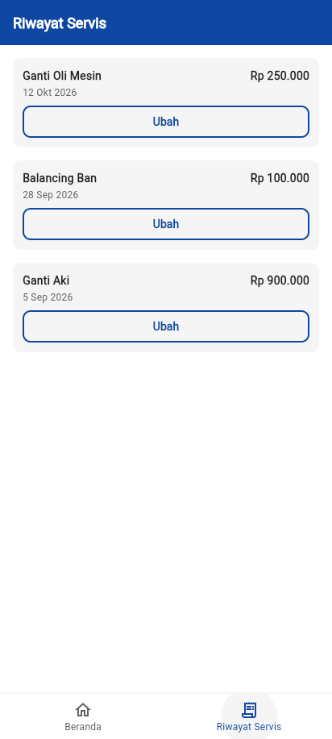

# MyGarage

**Buku servis digital untuk pemilik kendaraan bermotor** — catat riwayat perbaikan, biaya, dan dapatkan pengingat kapan servis berikutnya. Data tersimpan di Cloud Firestore, jadi tetap ada setelah aplikasi ditutup atau browser di-refresh.

| | |
|---|---|
| Mahasiswa | Anggaradyan Jannes Minardi |
| NIM / Kelas | 22.01.65.0002 / A1 (Pagi) |
| Mata kuliah | Mobile and Web Application Development — UNISBANK, Ganjil 2026/2027 |
| Platform | Mobile + Web (Flutter cross-platform) |
| Wireframe | [2201650002 - MyGarage - Wireframe (Figma)](https://www.figma.com/design/S5iVPGaOGy1oqVoXQYsrmH/2201650002-MyGarage-Wireframe) |

## Deskripsi

Pemilik kendaraan saat ini mengandalkan nota kertas yang mudah hilang dan ingatan untuk jadwal servis. Akibatnya perawatan telat dan biaya perbaikan membengkak. MyGarage menggantinya dengan buku servis digital: setiap selesai dari bengkel, pengguna mencatat jenis perbaikan, tanggal, kilometer, dan biaya — aplikasi menampilkan riwayat terurut dan indikator pengingat (hijau = sudah servis, merah = sudah ≥3 bulan sejak servis terakhir).

## Fitur (MVP)

- **K1 — Login** (MUST): masuk/daftar dengan email + kata sandi lewat **Firebase Authentication**; galat ditampilkan dalam Bahasa Indonesia, email terdaftar tidak dibocorkan, tersedia reset kata sandi.
- **K2 — Tambah Catatan Servis** (MUST): form Nama Perbaikan, Kendaraan (pilihan dari collection `kendaraan`), Tanggal (date picker), Kilometer, Biaya (Rp) — validasi: jenis wajib, biaya wajib, biaya > 0 (tanpa plafon biaya).
- **K3 — Riwayat Servis** (MUST): daftar urut dari tanggal terbaru, dibaca real-time per pengguna (`StreamBuilder`), dengan keadaan loading / galat / kosong. Setiap catatan punya aksi **Ubah** dan **Hapus**; hapus selalu lewat dialog konfirmasi.
- **K4 — Indikator Pengingat** (MUST): blok hijau/merah di Beranda berdasarkan tanggal servis terakhir (≥3 bulan = merah).
- **K5 — Responsif** (SHOULD): versi web memakai sidebar + tabel; versi mobile memakai bottom navigation + kartu.
- **K6 — Push Notification** (WON'T): sengaja tidak dibuat (melanggar batasan Firebase Spark tanpa billing).

## Screenshot

| Login | Beranda | Form Tambah | Riwayat Servis |
|---|---|---|---|
|  |  |  |  |

## Tech stack

- **Flutter + Dart** — UI dan logika (satu basis kode untuk Android & web)
- **Firebase Spark (gratis)** — Authentication (email/password) + **Cloud Firestore** (`cloud_firestore` 7.1.0) untuk seluruh data
- **Figma** — wireframe & style guide (#0D47A1 navy, Inter 24/18/14/12, radius 10, target sentuh 48 px)
- **GitHub** — versi kode

## Struktur data (Cloud Firestore)

Tiga collection top-level. Nama kendaraan **disalin (denormalisasi)** ke setiap catatan servis karena Firestore tidak mendukung JOIN antar-collection.

```
users/{uid}                     Doc ID = uid Firebase Authentication
  id_pengguna:   string
  nama_lengkap:  string
  email:         string
  nomor_telepon: string
  peran:         string
  dibuat_pada:   timestamp

kendaraan/{id_kendaraan}        master data, di-seed otomatis sekali
  id_kendaraan:  string
  nama_kendaraan:string
  merek:         string
  tahun:         number
  plat_nomor:    string

servis/{id_catatan}             Doc ID = id_catatan (seed: {uid}_{id_catatan})
  id_catatan:    number
  id_pengguna:   string         <- pemilik (uid); dasar filter & isolasi data
  id_kendaraan:  string
  nama_kendaraan:string        <- denormalisasi dari collection kendaraan
  jenis:         string
  tanggal:       timestamp
  kilometer:     number?        (opsional)
  biaya:         number         (rupiah)
  dibuat_pada:   timestamp      <- tidak berubah saat Ubah
  diubah_pada:   timestamp?     <- diisi server setiap Ubah (update())
```

Setiap pengguna hanya melihat catatannya sendiri: query memakai satu `.where('id_pengguna', isEqualTo: uid)` dan pengurutan dilakukan di sisi Dart, sehingga tidak butuh composite index.

### Aturan bisnis: tolak catatan ganda

Satu jenis servis tidak boleh dicatat dua kali pada tanggal yang sama oleh pengguna yang sama (adaptasi aturan "tolak jadwal bentrok" pada studi kasus modul). Pelanggaran ditolak sebelum menulis dokumen dan ditampilkan sebagai SnackBar merah; form tetap terbuka dengan isian utuh.

### Security Rules

`firestore.rules` — aturan kepemilikan, sudah dipublikasi dan dibaca ulang dari server (bukan hanya salinan repo):

```
rules_version = '2';
service cloud.firestore {
  match /databases/{database}/documents {
    function sudahMasuk() {
      return request.auth != null;
    }
    function pemilik(data) {
      return sudahMasuk() && data.id_pengguna == request.auth.uid;
    }
    match /users/{uid} {
      allow read, write: if sudahMasuk() && request.auth.uid == uid;
    }
    match /kendaraan/{idKendaraan} {
      allow read, write: if sudahMasuk();
    }
    match /servis/{idCatatan} {
      allow create: if pemilik(request.resource.data);
      allow read: if sudahMasuk();
      allow update: if pemilik(resource.data)
                    && request.resource.data.id_pengguna == resource.data.id_pengguna;
      allow delete: if pemilik(resource.data);
    }
  }
}
```

Aturan bisnis yang sama juga diperiksa di layanan (`pastikanBolehDiubah()`) supaya pesan galatnya jelas; Rules tetap penjaga terakhir di server. `allow update` dan `allow delete` dipisah karena saat delete `request.resource` bernilai null.

### Aturan bisnis: ubah & hapus hanya oleh pemilik

MyGarage tidak punya alur persetujuan seperti status "Menunggu" pada studi kasus modul, sehingga pagar operasi ubah/hapus adalah **kepemilikan**: `pastikanBolehDiubah()` membandingkan `id_pengguna` dokumen dengan uid yang sedang login (dicek di layanan, bukan hanya menyembunyikan tombol). Ubah memakai `update()` — `dibuat_pada` dan `id_pengguna` tetap, `diubah_pada` diisi `serverTimestamp()` — dan cek bentrok mengecualikan catatan itu sendiri. Hapus hanya lewat dialog konfirmasi dan `delete()`.

## Struktur kode

| Berkas | Isi |
|---|---|
| `lib/main.dart` | UI: Login, Beranda, Riwayat, Form Tambah/Ubah, navigasi mobile & web |
| `lib/models.dart` | Model `Pengguna`, `Kendaraan`, `CatatanServis` + `toMap`/`fromMap` |
| `lib/services/layanan_firestore.dart` | Satu pintu ke database: `LayananData` (abstrak), `LayananFirestore`, `LayananMemori` (untuk widget test tanpa Firebase) |
| `firestore.rules` | Security Rules yang dipublikasi di Console |
| `test/` | 50 test: unit aturan validasi, unit auth, form K01–K12, status pengingat, layanan Firestore (F01–F12), ubah/hapus (U01–U08), model, golden screenshot |

## Cara menjalankan

```bash
flutter pub get
flutter run -d chrome --web-port 8080   # versi web
flutter run                             # pilih device/emulator Android
```

Untuk melihat tampilan mobile di browser: Chrome → F12 → Toggle device toolbar (Ctrl+Shift+M) → ukuran 412x917.

## Pengujian

```bash
flutter analyze   # No issues found
flutter test      # 50 kasus, semua lulus
```

Rincian: 5 unit `periksaCatatan` · 3 unit validasi login + pesan galat · 5 widget login L01–L05 · 3 unit `statusPengingat` · 12 widget form K01–K12 · 12 test Firestore F01–F12 · 8 test ubah/hapus U01–U08 · 1 unit `toMap`/`fromMap` · 1 golden screenshot (4 layar 412×917).

### Tabel uji Cloud Firestore

Kolom "Cara verifikasi": **REST** = panggilan langsung ke Firestore dengan token akun uji (bukti data di server), **test** = `flutter test`, **Chrome** = diuji manual di browser.

| # | Kasus uji | Langkah | Hasil yang diharapkan | Hasil nyata | Cara verifikasi |
|---|---|---|---|---|---|
| 1 | Tambah data valid | Login → Beranda → Tambah Servis → isi Nama Perbaikan, Kendaraan, Tanggal, Biaya → Simpan | SnackBar hijau "Catatan servis disimpan"; kartu muncul di Riwayat; dokumen masuk collection `servis` dengan `id_pengguna` = uid | Dokumen tertulis `HTTP 200` dan terbaca kembali sebagai `['Ganti Oli Mesin']` oleh pemiliknya; kartu Riwayat muncul di test widget | REST + test |
| 2 | Tolak catatan ganda | Simpan "Ganti Oli Mesin" tanggal X, lalu simpan lagi jenis sama tanggal sama | SnackBar merah "Catatan servis untuk tanggal ini sudah ada"; form tetap terbuka; dokumen tidak bertambah | `CatatanDuplikatException` terlempar; SnackBar merah tampil; jumlah kartu tetap 1 | test (F04, F07) |
| 3 | Bertahan saat refresh | Simpan catatan → tekan F5 di Chrome (atau login ulang) | Data tetap tampil karena dibaca dari Firestore, bukan memori | Dokumen tetap ada saat dibaca dengan token baru (sesi baru), jadi sumber datanya server | REST + test |
| 4 | Isolasi antar akun | Akun A simpan catatan → keluar → masuk akun B → buka Riwayat | Riwayat B kosong; catatan A tidak terlihat | Akun B membaca `servis` → `200` dengan **0 dokumen** milik A | REST (dua akun uji) |
| 5 | Security Rules | Akses tanpa login; lalu ulangi dengan token | Tanpa login `permission-denied`; dengan login `200` | Tanpa token `403 PERMISSION_DENIED`; dengan token `200` | REST |

Catatan: baris 1–5 sudah diverifikasi dari sisi server; klik-uji manual di Chrome tetap disarankan sekali untuk merekam tangkapan layar Console (isi ketiga collection) sebagai lampiran.

### Tabel uji CRUD (Ubah & Hapus)

Kolom "Cara verifikasi": **REST** = panggilan Firestore dengan token akun uji, **test** = `flutter test`, **Chrome** = diuji manual di browser oleh pemilik akun.

| # | Kasus uji | Langkah | Hasil yang diharapkan | Hasil nyata | Cara verifikasi |
|---|---|---|---|---|---|
| 1 | Ubah data valid | Riwayat → Ubah → ganti biaya → Simpan | SnackBar "diperbarui"; dokumen berubah; `dibuat_pada` & `id_pengguna` tetap; `diubah_pada` terisi | REST `PATCH` field `biaya` + `diubah_pada` → `200`; `dibuat_pada` tetap `2026-01-01T00:00:00Z`; widget U06 menampilkan Rp 300.000 | REST + test |
| 2 | Ubah jadi bentrok | Ubah jenis/tanggal menjadi milik catatan lain | Ditolak; data lama utuh | `CatatanDuplikatException`; "Balancing Ban" tidak berubah | test U02 |
| 3 | Ubah/hapus bukan pemilik | Akun B mencoba mengubah/menghapus dokumen akun A | Ditolak dengan pesan jelas; Rules menolak | `OperasiDitolakException` di layanan; REST update sebagai B → `403 PERMISSION_DENIED` | test U03 + REST |
| 4 | Hapus dengan konfirmasi | Hapus → dialog → Hapus | Dokumen hilang; SnackBar hijau | REST DELETE pemilik → `200`, GET berikutnya `404`; widget U08 kartu hilang + SnackBar | REST + test |
| 5 | Hapus dibatalkan | Hapus → Batal | Dialog tertutup; data tetap | U07: catatan masih tampil, jumlah tetap 3 | test |
| 6 | Hapus milik akun lain | Akun B menghapus dokumen akun A | Ditolak | REST DELETE sebagai B → `403 PERMISSION_DENIED`; U03 menolak sebelum menulis | test + REST |
| 7 | Seed tidak muncul lagi | Hapus semua catatan → refresh/login ulang | Riwayat tetap kosong | Penanda `sudah_ditanam` di `users/{uid}`; U04 memastikan tidak di-seed ulang | test |
